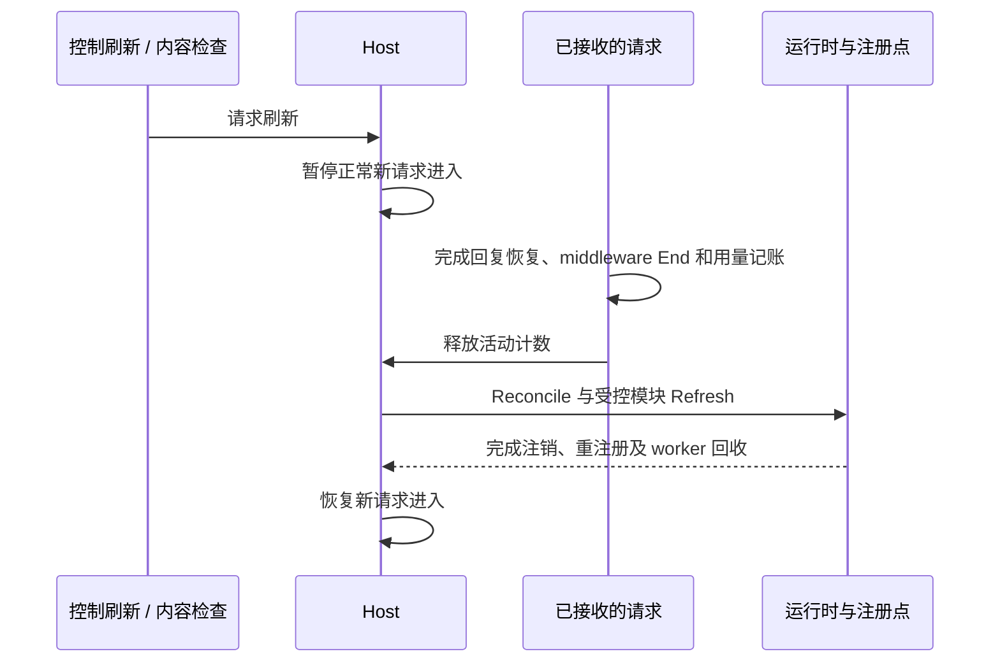

# 鲸桥网关插件注册与服务生命周期 · 2026-10-23

本轮把此前的依赖梳理落实到鲸桥实际 `RunContext`，继续以固定 Magpie 快照 `e00fbdbbc74f9829027a78769cbeb265d6271fb4` 为核对范围。完整供应商、发现、搜索与 Agent 来源仍为 `a75de4c21ac28be98af8334643077d8b0bf47df7`；本轮按边界适配，不是整体前移基线。

## 生产装配与首次注册

[实际入口](../internal/whalebridge/web.go) 自己创建两个 loopback HTTP 服务，仍不调用上游 `gateway.ListenAndServe`。[有限装配](../internal/gatewayplugins/assembly.go) 只包含四个模块：

| 模块 | 注册与资源 | 配置使用保护 |
| --- | --- | --- |
| `rotation` | [routes](../internal/routes/routes.go) 的六种内置策略：顺序、轮换、用量、剩余额度、权重、免费优先。智能策略属于核心。 | 严格读取已保存供应商与组的路由字段，包含隐藏、停用、无账号和无端点项；读失败按仍在使用。 |
| `middleware` | [gwmw](../internal/gwmw/gwmw.go) 的 JS 请求/回复适配与 [Ledger observer](../internal/usage/observe.go)；策略和用量 worker 由 [middleware](../internal/middleware/points.go) 管理。 | 使用 checked 插件清单及模块发现；开启的 gateway 模块算在用，读取失败不会被当成零个。 |
| `redact` | 既有 [redact](../internal/redact/redact.go) 能力的 [Masker 适配](../internal/masking/masking.go)。 | 当前设置要求秘密、个人信息或自定词脱敏时强制开启；设置不可读不会推断为隐私已关闭。 |
| `otel` | 原有 `StartOTel` 的单一 exporter，由模块负责启动和停止。 | 设置或环境要求导出时保持开启；不引入原生会话扫描。 |

[Host](../internal/gatewayplugins/host.go) 首次同步读取、Compose、Apply 成功后，入口才写 DSH 渠道、开始 HTTP 服务并发布 ready。首次配置错误或 Apply 失败会回滚已登记资源并返回错误。`gateway.New()` 继续是构造器，不启动插件、轮询或 exporter；包初始化也不隐式启用策略。独立测试的 bootstrap 是显式测试设置，真实入口另有冷启动验证。

没有导入上游 `plugins/all`、窗口内核、GUI contributions、LAN 服务、客户端安装或原生账号切换。Go 内置模块配置是组件目录里的 `plugins.yml`；原有供应商与 gateway JS 插件仍使用 `plugins.json`。

## 热更采用排空窗口

本轮选择可验证的排空后切换语义。刷新期间正常新网关请求等待，已接收的请求继续；长 SSE 会延后本次切换及新请求。这里没有宣称无等待的逐请求注册代际快照。

- 闸门只在计数和状态变化时持短锁；不跨请求、Apply、销毁回调或 worker join 持锁。管理 HTTP 不占网关请求计数，控制刷新不会等待自己。
- Claude 已接收请求需要的内部 MCP 回调可在等待排空时继续进入，并由原私有 Handler 做地址/来源校验；回调同样计入活动数。真正 Apply 期间不接收回调，避免它读取半切换状态。
- 新请求进入前以及每秒 watcher 检查 `plugins.yml`、供应商配置、设置、`plugins.json` 和 gateway 模块/本地 JS、MJS、TS 文件的内容 hash。等长且修改时间被还原的编辑仍能识别。读失败保留现有可用状态，并通过状态/刷新错误反馈；watcher 重试而非等待下一次编辑。
- `middleware.ManagedRefresh` 把原来的请求检查、Reload 和内部轮询改为只调度 Host。生产中模块注册的实际改变只在 Host 排空之后发生，不允许自身计时器绕过闸门。独立使用 middleware 时仍可采用它自己的刷新模式。
- 缺 Masker 的出站调用只异步安排刷新；当前调用立即失败关闭。请求内部不会同步进入等待自己的控制刷新。请求前的设置内容检查可在下一次正常准入时立即应用新的隐私要求。
- 取消的请求或控制刷新不再进入下游或提交注册变化；停止中的 Host 拒绝后续刷新。错误配置字节保持原样。

[无页面运行时](../internal/pluginrt/pluginrt.go) 提供依赖顺序、API 版本校验、部分 Apply 回滚、短状态锁、重入操作拒绝、反向撤销和可取消 worker。活动配置变化会重应用它及受影响的使用方；失败时尽力恢复原活动链旧配置，仍返回新配置错误，恢复失败也报告且只尝试一次。显式关闭项不会被恢复。这里不是跨注册点的原子事务。

## 关闭顺序

`Run` 将操作系统中断/终止信号转为 `RunContext` 的停止请求。关闭由一个入口拥有：

1. 移除 ready 状态，关闭正常网关准入，禁止新的配置提交。
2. 取消并等待 Host watcher、配置/目录同步及订阅维护任务；管理 HTTP 停止接受请求并等待在途管理操作。
3. 保留网关 listener，允许已接收 Claude 请求完成所需内部回调；等待全部网关 Handler（含 GET、辅助回调、最终 Finish 与用量代码）退出。
4. 原子封闭最后准入并 `Shutdown` 网关 HTTP。服务请求的上下文不因父 context 先取消，SSE 可正常完成；WebSocket 仍明确返回 426，没有新增 hijack 连接。
5. 终止并回收闲置/停驻 Claude 会话。额外的 reaper WaitGroup 覆盖已被 abort 从运行表移除的子进程，等待输出读取和进程回收结束，不能只遍历当前 map。
6. 反向注销模块、取消并等待 JS/运行时 worker，既有 OTel 接受队列至多排空三秒并等待 exporter 退出，清除调度回调。Stop 幂等，之后 Reload/Refresh 不能复活已退出服务。

关闭和热更都等待已接收请求自然结束，本轮没有加入强制截断流的超时策略。外部强制终止进程仍由启动器/操作系统决定，不声称能在强杀后完成 Go defer。

## 统一权重状态与未注册行为

轮换、供应商密钥权重、组成员权重和会话亲和补偿共用 [routes round](../internal/routes/round.go)，网关不再保留第二套 `routed.turn/wrr`。注销、再注册及其他配置刷新保持轮次历史；只有明确 `Forget` 重置。

每次权重选择返回独立凭证，记录本次选择、总权重及成员版本。亲和补偿只调整本请求的凭证，单次使用；另一并发请求的选择不会覆盖它，修改成员/权重或重置会使旧凭证失效。嵌套组保留各自凭证，子组内换账号不会错误补偿外层组。

排序之外的组头部规划、轮次 trace、Sink、会话轮换与亲和全部读取有效注册语义。策略未注册时，保存的策略名保留，但行为一致退到列表顺序。内置名称不能被任意算法冒用；自定义策略使用 `plugin/name`。Free first 保留前轮的实际账号免费事实、全计费档位检查及按身份/模型的单候选 trace，没有回退上游较弱行为。

## JS 策略、用量与鲸桥页面

gateway 模块支持已有 `onRequest/onEvent/onResponse`，以及：

- `strategies: {name: (pool, seats, options) => indexes}`。20ms 包含等待模块 runtime；结果必须是候选排列。异常、超时或非法结果保留全部候选原顺序，之后仍服从协议门控。当前自定义策略不主动读取免费目录，`Free` 不是对所有 JS 策略实时计算的承诺。
- `onUsage(row, options)`。只收到字段白名单，没有正文、prompt、错误文本、session 或请求 ID；1024 项有界队列、250ms 超时，满队列丢弃并计数，不阻塞账本。停止时退出并等待 worker，未处理队列可丢弃；它不是可靠投递总线。

Ledger observer 只在账本成功写入后通知一次。它是本轮实际需要的最小观察接口，不是上游完整 `Begin/Watch/Attempt/End` 遥测迁移。现有请求、尝试、正文限制、`ExportOTel/SkipOTel` 和 exporter 路径保持原契约，避免双重导出。

只有实际已加载策略进入 `state.runtimeRoutings`。供应商/组选择器与路由记录显示插件标签；已保存但未加载的策略保持选中并说明暂按列表顺序，修改其他字段不会清空选择。运行状态在私有 Cookie 管理 API `GET /api/runtime`，立即控制刷新为 `POST /api/runtime/refresh`；没有增加公开网关管理端点。

## 脱敏失败关闭与恢复

所有当前要求脱敏的普通 Chat/Messages/Responses、count_tokens、Codex/Alpha search、embeddings/rerank、图片/视频提示、搜索及路由决策出口都传播 Masker 缺失、panic 或设置不可读的错误，并在调用供应商前停止。错误不包含 panic 的原值。显式本地不脱敏例外仍按原来源/备用边界判定，不以注册缺失取消用户已选择的例外。

请求捕获对应 Masker 的恢复器；JS 的请求 Run 同样持有原模块对象，直到回复结束。已创建视频后续轮询的占位符使用既有持久恢复存储，即使后来关闭隐私/卸下 Masker 也能复原旧回复；这个只恢复入口不授予新的不脱敏出站能力。没有新增模型识别、隐私 actions 或上游 before 状态。

## 来源与验证

局部来源：[`3ccbe6bc`](https://github.com/yetone/magpie/commit/3ccbe6bc15c96a0cbb47ea574645fa5def3699fa)（无页面运行时）、[`af9bd6c3`](https://github.com/yetone/magpie/commit/af9bd6c3e227ed8a6baac5df8b33f6e934981005)（策略注册）、[`9916a946`](https://github.com/yetone/magpie/commit/9916a946080918074bc40e964613928d1a1b283f)（本轮最小 Ledger observer）、[`4ac4d9ba`](https://github.com/yetone/magpie/commit/4ac4d9ba995057935e40664b1196938130ffa815)（gwmw/Masker）与 [`3f913b3d`](https://github.com/yetone/magpie/commit/3f913b3de6b1ad51c88016c605321a02aab6dee4)（JS 策略、onUsage 与已保存策略选择）。P1 原 GUI/schema 没有移植。

已针对首次启动、配置错误、依赖/回滚、活动配置重应用、watch/Apply/Stop 竞态、辅助回调、持流刷新/退出、JS 改名与注销、共享权重凭证及各出口失败关闭添加本地回归。最终包测试、构建与已知环境限制统一记录在 [审查记录](upstream-review-2026-10-23.md)。
