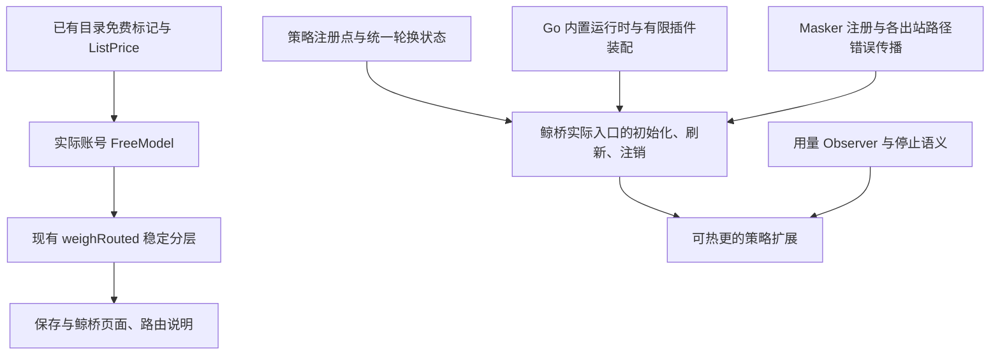

# Free first 与网关插件注册的依赖边界 · 2026-10-23

本说明保留免费优先轮的依赖梳理。后续网关注册轮已完成有限装配、首次同步应用、排空式热更和关闭，实际实现与验证边界以 [网关插件生命周期说明](gateway-plugin-runtime-2026-10-23.md) 为准；下文“后续”描述的是梳理时的待办。

本轮继续比较鲸桥现有工作树与固定 Magpie 快照 [`e00fbdbbc74f9829027a78769cbeb265d6271fb4`](https://github.com/yetone/magpie/commit/e00fbdbbc74f9829027a78769cbeb265d6271fb4)。Free first 的来源为 [`75e769a9`](https://github.com/yetone/magpie/commit/75e769a9f9b419f805b925f147146eff179111b9)，同时核对了该提交的上游记录；快照目录是源码归档，不是独立 Git 仓库。完整功能来源仍保持原基线，不能把本轮局部适配描述为全部 961 个提交已同步。

## 本轮决策

Free first 可直接接入当前内联路由，不需要重构供应商插件宿主或引入 Go 内置功能运行时、Observer、Masker 注册。插件宿主仅补保全逐账号免费事实的元数据。本轮先交付免费判断、保存、排序、路由解释和鲸桥页面这一完整闭包。

网关插件注册需要单独管理注册状态与实际服务生命周期。本轮完成依赖和范围梳理，保留当前可工作的内联策略和脱敏，不添加没有生产消费者的空注册包。P1 页面内核迁移不是路由注册的技术前置，Observer 也不是策略注册的技术前置；二者在上游演进顺序上相邻，不能据此视为必须整体导入。

## Free first 的独立闭包

| 部分 | 当前依赖和改动 | 行为边界 |
| --- | --- | --- |
| 策略名与保存 | [策略常量](../internal/provider/routing.go)、[供应商保存](../internal/provider/provider.go)、[路由组保存](../internal/provider/group.go) | 新增 `free`，两处规范化白名单都接受；非法策略仍按原规则恢复智能。既有配置不自动改用免费优先。 |
| 免费判断 | [模型元数据](../internal/provider/models.go)、已有 `ListPrice` 与 `catalog.Model.Free` | 当前候选账号的供应商明确说免费，或已知原始报价的所有计费维度、所有档位都为零。缺价、名字含 free、免费套餐名称、本地倍率及价格覆盖都不能单独证明免费。目录读取不主动刷新网络。 |
| 插件账号 | [插件宿主](../internal/plugin/host.js)、[账号缓存](../internal/plugin/providers.go) 与 [插件目录](../internal/provider/plugins.go) | 主供应商用于展示的多账号目录并集保持原样。增加账号自己的 `freeModels` 完整集合，保全同一模型在不同账号上的免费差异；`nil` 是未知、`[]` 是明确没有免费模型。缓存写入、读回、同账号失败保留都带上此字段，实际排序同时检查该账号的可用模型。没有扩展逐账号价格协议。 |
| 排序 | [内联路由](../internal/gateway/routing.go) | 免费候选在前，其余在后，各层保持原顺序。不在付费层额外应用智能、用量或权重排序；仅免费优先需要读取免费事实。 |
| 规划与回退 | [组规划与回退](../internal/gateway/fallback.go)、[会话亲和](../internal/gateway/affinity.go)、[限流沉底](../internal/gateway/sink.go) | 原组头部规划可直接复用，不全局重排展开后的候选。子组或显式另设策略的供应商保留自己的顺序。健康的付费主供应商仍先于其免费备用供应商；要跨来源比较应放进免费优先组。 |
| 路由解释 | [候选 trace](../internal/gateway/trace.go)、[路由详情](../internal/whalebridge/assets/global.js) | 免费事实按账号/密钥身份和模型一起记录；单候选也可说明免费。未采用该判断的其他策略，不用 `free=false` 推断一定付费。 |
| 页面与 API | [供应商和组编辑器](../internal/whalebridge/assets/app.js)、[账号摘要](../internal/whalebridge/assets/accounts.js)、既有保存/API/加密备份 | 选择、保存、刷新、重开和备份往返保持 `free`。说明免费优先仍可能回退付费，且继续服从协议适配、冷却和会话亲和。 |

“免费优先”是排序偏好。账号/模型关闭、权限限制、用量上限、协议门控、既有冷却、限流沉底、规则和会话亲和仍生效。严格亲和会保留指定账号；普通会话也可能继续由此前的付费候选回答。它不承诺全程零费用，不修改余额和额度休息的判断。

相对来源的三项明确增强：原实现只检查四个基础价格，本轮同时检查一小时缓存与全部上下文价格档位；原 trace 按身份记录会混淆同账号的免费与付费模型，本轮按身份和模型区分；原实现单候选提前返回不填免费 trace，本轮保留解释。另针对鲸桥前轮已有的插件目录并集，既检查实际账号的可用列表，也保全账号自己的 `freeModels`；只过滤模型 ID 不足以阻止同名模型借用第一账号的免费事实。新宿主即使只有一个账号也给完整集合。旧缓存没有该事实时保守视为未知，即便当前只剩一个账号，也不信任可能来自此前其他账号的合并标记；独立的已知全零原价仍有效，下次目录刷新会补齐新字段。

上游文档有一处不能照字面移植：文档称免费组按整个成员排序，但固定快照的可执行规划只有 `Weighted` 才一律按整个成员处理。Free first 继续沿已有规划：默认或同策略的供应商可逐密钥参与，子组和显式不同策略的供应商按头部作为完整单元。没有额外改变组的边界。

## 三套机制应分开理解

| 机制 | 当前或来源位置 | 本轮关系 |
| --- | --- | --- |
| 供应商/Agent 插件宿主 | 鲸桥已有 [Go 宿主](../internal/plugin/host.go)、[JS 宿主](../internal/plugin/host.js)、[供应商适配](../internal/provider/plugins.go) | 已有外部插件的认证、目录、请求与受控交接；不因 Free first 替换。 |
| Go 内置功能运行时 | 上游 `internal/pluginrt` 与 `plugins/*` | 通过 Manifest、服务依赖和 disposer 管理可启停的内置功能；不是现有 Bun 供应商插件宿主。 |
| 网关扩展注册点 | 上游 `internal/routes`、`internal/gwmw`、`usage.Observer`；后续 JS gateway/hook 扩展 | 分别处理候选顺序、中间件/脱敏和用量通知；不能把仅接受一种文件名或登记 Manifest 视为全部扩展已工作。 |

## 插件架构的实际范围与实施顺序

| 层次 | 来源与闭包 | 鲸桥必须处理的依赖 | 可独立程度 |
| --- | --- | --- | --- |
| P0 运行时 | [`3ccbe6bc`](https://github.com/yetone/magpie/commit/3ccbe6bc15c96a0cbb47ea574645fa5def3699fa)；固定快照的 `pluginrt.go/config.go/schema.go` | Manifest/服务顺序、失败回滚、反向注销、配置读取/合并、InUse；当前 Manifest 类型引用 schema，照最新接口移植时三文件一起考虑。已有活动配置变化不自动重新 Apply，必须明确采用即时读取或显式重配置。 | 可做无页面运行时；不能单独复制类型后就声称接入完成。 |
| 策略注册 | [`af9bd6c3`](https://github.com/yetone/magpie/commit/af9bd6c3e227ed8a6baac5df8b33f6e934981005)；`routes/{routes,strategies,round}.go` 与有限的 rotation 装配 | `Register` 栈与移除、panic/错误排列恢复；智能策略和其余策略来源；组权重、供应商权重、会话补偿统一使用同一轮换状态。当前测试对 `routed.turn/wrr` 的清理也要一起迁移。 | 类型上不依赖 Observer 或页面。可以先做保留内联默认行为的适配层，但必须有生产消费者，并明确这还没有策略关停语义。 |
| 状态一致性 | 路由之外的 [组规划](../internal/gateway/fallback.go)、[权重状态](../internal/gateway/weighted.go)、[沉底](../internal/gateway/sink.go)、[会话亲和](../internal/gateway/affinity.go) | 来源 `routingOf/goesRound` 在排序之外还决定轮次标记、组头部、会话分配、沉底和权重补偿。取消注册时，不能出现仅排序退回顺序、其他行为仍按轮换运行。 | 必须与完整策略提取共同验收；只移 `weighRouted` 会拆开权重状态。 |
| Observer | [`9916a946`](https://github.com/yetone/magpie/commit/9916a946080918074bc40e964613928d1a1b283f)；用量登记点与服务/停止 | 定义追加账本时通知、注册移除、消费者生命周期；如迁出 OTLP，替代当前 [OTel 启动](../internal/whalebridge/web.go) 与用量导出，避免双重上报。 | 用量行观察者可单独做；Free first 和纯 Go 策略不需要它。 |
| JS 策略与 onUsage | 固定快照 `internal/middleware/points.go` 及发现、模块状态、刷新、providers 允许的策略名 | 依赖策略和 Observer 两点；策略限时/并发等待及排列校验、用量非阻塞队列/超时；刷新时注销旧名称、取消并等待 worker，不能只清现有 middleware 缓存。保存及页面只列出实际可服务的名称。 | 是后续完整消费者，不能只改文件名识别就宣称支持。 |
| gwmw/Masker | [`4ac4d9ba`](https://github.com/yetone/magpie/commit/4ac4d9ba995057935e40664b1196938130ffa815)；注册点和现有脱敏适配 | Masker 缺失或 panic 时，已要求脱敏的请求应失败关闭；须把错误贯通普通模型、Codex、count_tokens、嵌入/音频、图片/视频、搜索/决策等所有出口及最终恢复。即时启用不能等轮询后才生效。 | 与策略/Observer 类型独立，可用现有 redact 适配；不能只换一处调用。来源新增隐私模型/动作等扩展不自动成为前置。 |
| P1 窗口内核/设置表单 | [`2dcc5141`](https://github.com/yetone/magpie/commit/2dcc51417e9df99cda2c3e0a172041af743f2f08) 及原 GUI 页拆分 | 鲸桥有自己的嵌入页面；只需为所接出的内置功能提供合适状态/设置接口，原 GUI、导航与翻译内核无需照搬。 | 页面架构迁移是可选工作，不阻塞无页面注册生命周期。 |

完整策略提取至少涉及当前网关的路由、权重、组规划、沉底、请求/会话策略判定及 trace，并联动测试状态清理。完整 Masker 接入还涉及 [脱敏助手](../internal/gateway/redact.go) 和各媒体、搜索及 Codex 出口；这不是一个登记函数替换。

## 鲸桥实际生命周期是关键前置

[主入口](../main.go) 调用的是 [whalebridge.Run](../internal/whalebridge/web.go)。`Run` 自行绑定 loopback 网关和管理页，构建 `gateway.New()`，启动已有 OTLP，然后用 `http.Server{Handler: server.Handler()}.Serve(...)` 提供服务。它没有调用上游 `gateway.ListenAndServe`。

因此只移上游监听函数中的 `KeepFresh`、observer、group/tool/masker gate，不会进入实际产品路径。不能为了注册而改调该函数：它还启动鲸桥范围外的 LAN、原生账号切换、会话及客户端维护行为。

后续应在鲸桥实际入口或其显式调用的独立生命周期 API 完成：

1. 使用有限、明确的插件装配清单，首次注册/Apply 在接受请求前同步完成。上游 `plugins/all` 会引入十四个内置功能包，不能直接作为鲸桥装配清单。
2. 监听配置及 InUse 相关文件，读失败保持已有有效状态；新请求立即需要的安全功能不能只等下一次轮询。设置变更与既有活动模块的重配置语义须明确。
3. 停止时先停止并等待刷新/worker，停止接受并排空请求，再移除仍被请求使用的 masker/策略/observer，最后反向释放其余资源，避免恢复响应时 masker 消失或晚到刷新重新注册。
4. 上游 `KeepFresh` 在 context 取消后只退出轮询，不自动调用 `Runtime.Stop`；存在 Stop 方法不代表实际生产关闭链已经接入。鲸桥当前服务返回主要关闭 listener，不能把现状当成已具备可注销插件的优雅排空。

## 验收门槛

Free first 验证包括实际私钥 Handler 与管理 HTTP、免费失败转付费、未知报价、同密钥多模型 trace、单候选、全部零价/非零档位、实际账号目录、组与供应商另设策略、主/备用边界、冷却沉底和严格亲和；页面保存/刷新/重开及既有策略回归，并用本地假服务完成。

后续注册架构至少还需验证：注册叠加与幂等移除；实际 `Run` 首次启动已有策略不退化；依赖 Apply/局部失败回滚/反向 Stop；配置损坏与活动配置更新；JS 刷新后旧策略消失；非法/慢/抛错策略保持候选全集；通知不阻塞账本；所有要求脱敏的入口缺 Masker/panic 时均零供应商请求；在途请求、热更与停止竞态；组权重与亲和共用状态。未经这些验证，不把完整插件架构标成已完成。

本轮继续保留私有本机密钥、显式 Agent 接入、插件与凭据所有权、既有媒体授权及恢复语义。实际完成情况和验证结果见 [审查记录](upstream-review-2026-10-23.md)。
